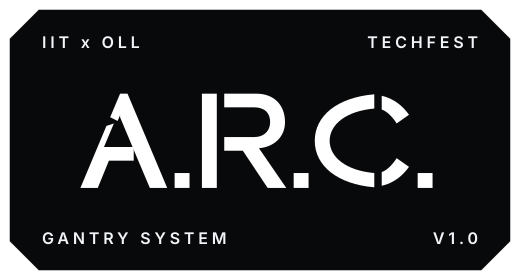
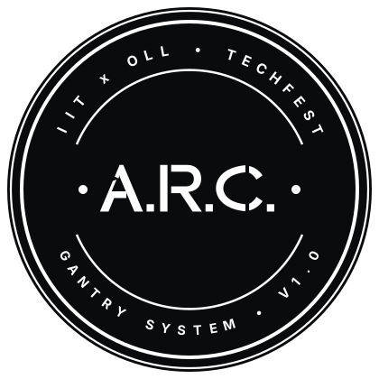
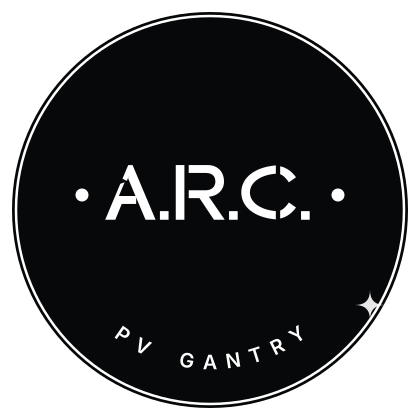

<div align="center">


<p><strong>Autonomous Robotic Cleaner for Photovoltaic Modules &amp; Precision Glass Testbeds</strong></p>

[](LICENSE)
[](cad/)
[](cad/src/)
[](src/main.cpp)
[](src/)
[](cad/tests/)
[](web/)

<p align="center">
  <a href="#overview">Overview</a> &bull;
  <a href="#system-architecture">Architecture</a> &bull;
  <a href="#parametric-cad-pipeline">CAD Pipeline</a> &bull;
  <a href="#embedded-firmware">Firmware</a> &bull;
  <a href="#interactive-3d-digital-twin">Digital Twin</a> &bull;
  <a href="#mechanical-specifications">Specifications</a> &bull;
  <a href="#branding--assets">Branding</a> &bull;
  <a href="#verification-and-testing">Testing</a> &bull;
  <a href="#quickstart">Quickstart</a>
</p>

</div>

---

## Overview

Project A.R.C. (Autonomous Robotic Cleaner) is an autonomous linear traversing maintenance system engineered to eliminate localized soiling and dry dust accumulation on commercial photovoltaic (PV) solar panels and flat architectural glass surfaces.

Operating along dual 2020 V-slot aluminum guide rails via a custom 3-wheel pinching gantry carriage, the robot combines high-contact mechanical shear using an 800 GSM plush microfiber roller drum with non-contact pneumatic dust mitigation. The platform restores optical transmission and panel power output without requiring water consumption.

```
+-------------------------------------------------------------------------+
|                         PROJECT A.R.C. TOPOLOGY                         |
+-------------------------------------------------------------------------+
|                                                                         |
|  [ Solar Array / Testbed ] <--- (Datum: Z = 0.00 mm)                    |
|             ^                                                           |
|             |  Uniform 1.20 mm Shear Compression                        |
|             v                                                           |
|     [ Microfiber Drum ] <======= (25GA-370 DC Geared Motor)             |
|             ^                                                           |
|             |  Dual Outboard Drive Traction                             |
|             v                                                           |
|     [ Motion Gantry ]   <======= (Twin N20 Micro Gearmotors)            |
|             ^                                                           |
|             |  PWM & Directional Control Signals                        |
|             v                                                           |
|     [ ESP32 Controller ] <------ (L298N Dual H-Bridge & Relay Module)   |
|             ^                                                           |
|             |  I2C Energy Telemetry                                     |
|             v                                                           |
|     [ INA219 Sensor ]   <------- (2S BAK 18650 7.4V Li-Ion Power Rail)  |
|                                                                         |
+-------------------------------------------------------------------------+
```

---

## System Architecture

The robot comprises five tightly integrated mechanical and electronic subsystems:

1. **3-Wheel Pinching Carriage**: Dual symmetrical PETG carriage endplates with an ultra-wide 110 mm wheelbase stance (0.32 span ratio against the 346 mm rail center-to-center track). Each plate houses two top Delrin Mini V-wheels riding the upper 90-degree V-groove and one bottom wheel with an adjustable eccentric spacer (+/-0.60 mm throw) to eliminate yaw racking and mechanical slop.
2. **Rotating Microfiber Drum**: A 320 mm UPVC core sleeved in 800 GSM plush microfiber, driven by an EN31 hardened steel axle (diameter 4.00 mm) running on dual 684ZZ precision miniature ball bearings and powered by an independent 25GA-370 high-torque DC gearmotor.
3. **Pneumatic Air Knife**: Aerodynamic dual-half cowl directing focused laminar airflow across the panel surface ahead of the microfiber sweep zone.
4. **Electronics Deck**: Elevated chassis tray housing an ESP32 microcontroller, L298N dual H-bridge motor driver, optically isolated 5V relay, and an INA219 current/voltage/power sensor.
5. **Precision Glass Testbed**: Structural aluminum base elevating the guide tracks and securing float glass (285 x 560 x 3.2 mm) permanently flush with the system cleaning datum (Z = 0.00 mm).

---

## Parametric CAD Pipeline

The physical robot is constructed entirely in code using Python and the `build123d` Boundary Representation (B-Rep) kernel (`cad/src/`).

```
cad/
├── src/
│   ├── assembly.py              # Full digital twin assembly hierarchy
│   ├── parameters.py            # Global parametric constraints & tolerances
│   ├── carriage_endplate.py     # 110 mm wheelbase gantry plate generator
│   ├── roller_assembly.py       # UPVC drum, end plugs, and axle assembly
│   ├── chassis_tray.py          # Standoff deck & electronics integration
│   ├── blower_cowl.py           # Split aerodynamic air knife generator
│   ├── solar_tilt_wedge.py      # Telemetry auxiliary PV mount
│   ├── limit_switch_dog.py      # Ramp-profile limit switch trip dog
│   ├── parts/                   # Low-level parametric component models
│   └── cots/                    # Standard commercial off-the-shelf library
├── tests/
│   └── test_geometry.py         # 57 automated clearance and tolerance unit tests
├── exports/
│   ├── glb/                     # WebGL glTF/GLB models for digital twin
│   ├── step/                    # Lossless OpenCASCADE STEP solids
│   ├── stl/                     # Watertight FDM 3D printing meshes
│   └── bom.csv                  # Parametric Bill of Materials manifest
└── export_all.py                # Headless batch export build pipeline
```

### Exporting CAD Artifacts
Run the headless export pipeline to generate all manufacturing STEP, STL, and GLB files:
```bash
python cad/export_all.py
```

---

## Embedded Firmware

The onboard firmware (`src/main.cpp`) is written in C++17 for the ESP32 platform using the PlatformIO build system. It executes a deterministic, non-blocking Finite State Machine (FSM):

```
                     +-------------------+
                     |    STATE_IDLE     |
                     +-------------------+
                               |
                   Target Serial Acquisition
                               |
                               v
                     +-------------------+
                     |   STATE_ACQUIRE   |
                     +-------------------+
                               |
                      Trajectory Planning
                               |
                               v
                     +-------------------+
                     |   STATE_FORWARD   |
                     +-------------------+
                               |
                     Time-to-Target Elapsed
                               |
                               v
                     +-------------------+
                     |    STATE_CLEAN    |
                     +-------------------+
                               |
                     Limit Switch Triggered
                               |
                               v
                     +-------------------+
                     |    STATE_DOCK     |
                     +-------------------+
                               |
                       Docking Sequence
                               |
                               v
                     [ Return to IDLE ]
```

### Firmware Features
* **Hardware Interrupt Handling**: Asynchronous pin change detection for limit switch trigger and emergency stop.
* **Energy Monitoring**: INA219 telemetry reporting bus voltage, current draw, instantaneous wattage, and cleaning energy efficiency (`eta_gain`).
* **Hardware-in-the-Loop Testing**: Automated Python serial test suite (`scripts/test_hardware.py`) for validating state transitions and sensor response under simulated loads.

---

## Interactive 3D Digital Twin

The web platform (`web/index.html`) provides an interactive 3D digital twin of Project A.R.C. built with `<model-viewer>` and Three.js:

* **Real-Time 3D Inspection**: Fluid orbit camera controls, studio softbox lighting, and physical PBR materials.
* **Interactive Exploded Assembly**: Hierarchical 33-part disassembly slider mapping outward translations along X, Y, and Z axes.
* **Integrated Documentation**: Direct download access to verified CAD STEP models, sliced STLs, and the engineering whitepaper.
* **Offline-First Resilience**: Loads locally via `scripts/model-viewer.min.js` with automatic CDN fallback when offline.

To launch the web interface locally:
```bash
./start_website.sh
```

---

## Mechanical Specifications

| Parameter | Specification | Engineering Basis |
| :--- | :--- | :--- |
| **Track Dimensions** | 20 x 20 x 600.0 mm (Y-axis) | 6063-T5 silver anodized V-slot extrusion |
| **Crossbeam Length** | 340.0 mm (X-axis) | Center-to-center carriage track: 346.0 mm |
| **Gantry Wheelbase** | 110.0 mm | Wheelbase-to-span ratio: 0.318 (anti-racking) |
| **Guide Wheels** | 6x OpenBuilds Delrin Mini V | Dual upper idlers + single bottom eccentric clamp |
| **Cleaning Roller** | OD 41.2 mm UPVC, 320.0 mm length | 800 GSM plush microfiber wrap (OD 50.0 mm) |
| **Roller Axle** | Ground Steel EN31, dia 4.00 x 390.0 mm | Supported by dual 684ZZ miniature ball bearings |
| **Compression Depth** | 1.20 mm on glass | Axle centerline at Z = +25.30 mm, Glass at Z = 0.00 mm |
| **Drive Motors** | 2x N20 Micro Metal Gearmotors | 6V nominal, 300 RPM, direct rim drive |
| **Roller Motor** | 1x 25GA-370 DC Geared Motor | High-torque low-speed roller rotation |
| **Power Storage** | 2S BAK 18650 Li-ion (7.4V nominal) | 2600 mAh capacity with onboard INA219 monitor |
| **Microcontroller** | NodeMCU ESP32-WROOM-32D | 240 MHz dual-core Tensilica Xtensa LX6 |
| **Total System Mass** | 1,358.5 g (Phase 1 Baseline) | Dynamic tractive safety factor: 14.58x |

---

## Branding & Visual Identity

The project includes an original vector brand design system generated purely in code (`web/assets/branding/`):

<div align="center">
  <table border="0">
    <tr>
      <td align="center" width="50%">
        <br />
        <sub><b>01 Horizontal Inline</b> &mdash; Master System Header</sub>
      </td>
      <td align="center" width="50%">
        <br />
        <sub><b>02 Hardware Badge</b> &mdash; Chassis & Enclosure Label</sub>
      </td>
    </tr>
    <tr>
      <td align="center" width="50%">
        <br />
        <sub><b>03 Circular Seal</b> &mdash; Hardware Certification Emblem</sub>
      </td>
      <td align="center" width="50%">
        <br />
        <sub><b>03 Minimal Emblem</b> &mdash; Precision Gantry Monogram</sub>
      </td>
    </tr>
  </table>
</div>

---

## Verification and Testing

### CAD Geometric Clearances (pytest)
The physical assembly is validated using a comprehensive unit test suite:
```bash
pytest cad/tests/test_geometry.py
```
```text
============================= test session starts ==============================
collected 57 items

cad/tests/test_geometry.py ............................................. [ 78%]
............                                                             [100%]

======================= 57 passed, 16 warnings in 10.18s =======================
```
Unit test assertions enforce:
* Non-negative volume and non-collision between rotating roller and crossbeam.
* Wheel centerlines matching the 2020 extrusion V-slot datum.
* Standoff pitch matching the ESP32 adapter sled grid ($71.0 \times 57.0\text{ mm}$).
* Monotonic cam profile slope on the limit switch trip dog.

### Telemetry & Vision Pipeline
* **`scripts/arc_gui.py`**: Real-time OpenCV dashboard displaying live camera feed, target detection bounding box, FSM state chips, and power graph.
* **`scripts/vision_pipeline.py`**: HSV color isolation and centroid tracking for solar panel edge detection.
* **`scripts/test_hardware.py`**: Hardware-in-the-loop automated serial test simulating optical targets and asserting correct state transitions.

---

## Quickstart

### Prerequisites
* Python 3.10 or higher
* [Build123d](https://github.com/gumyr/build123d) (`pip install build123d`)
* PlatformIO CLI (`pip install platformio`)
* OpenCV Python (`pip install opencv-python numpy pyserial`)

### Running the Digital Twin
```bash
git clone https://github.com/atharvajshinde/Project-A.R.C..git
cd Project-A.R.C.
./start_website.sh
```

### Running Test Suite
```bash
pytest cad/tests/
```

### Building Firmware
```bash
pio run
```

---

## Documentation

* **Engineering Specification**: The complete 15-page master report covering mathematical validations, motor torque margins, and kinematic sensitivity analysis is available in [`docs/ARC-MASTERDOC.pdf`](docs/ARC-MASTERDOC.pdf) (LaTeX source: [`docs/ARC-MASTERDOC.tex`](docs/ARC-MASTERDOC.tex)).
* **Assembly Guide**: A modular 4-stage workshop assembly manual is provided in [`assembly_guide.md`](assembly_guide.md).
* **Manufacturing Manifest**: Print parameters, infill percentages, and wall counts for PETG components are documented in [`cad/manufacturing_manifest.md`](cad/manufacturing_manifest.md).

---

## License

This project is licensed under the MIT License. See the [LICENSE](LICENSE) file for details.
