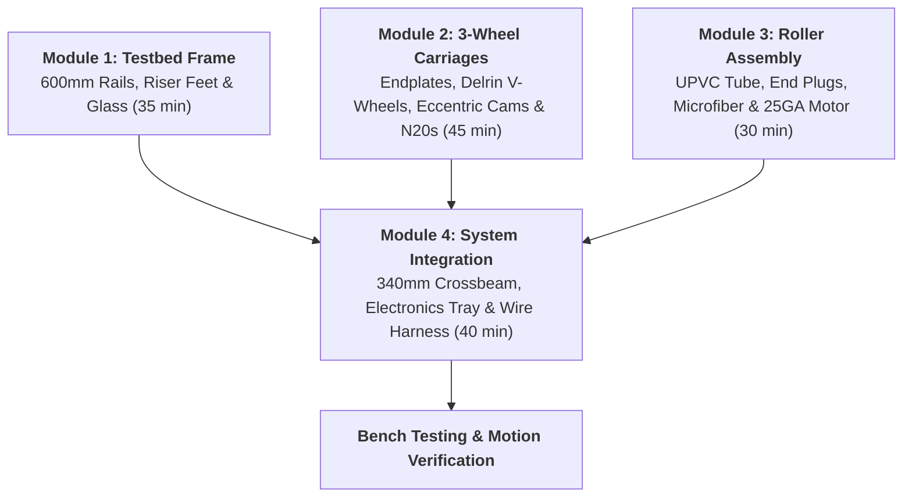

# Project A.R.C. — Modular Assembly Guide
**Autonomous Roller Cleaner for Solar Panels & Glass Testbed**

> [!NOTE]  
> **Session Format:** Tailored for 30–45 minute school workshop periods. Each module is fully self-contained so your team can complete one subassembly per school day without leaving loose parts around.

---


---

## Workbench Preparation & Tool Kit

Have these tools ready at the start of each session:
* **Allen / Hex Keys:** 1.5 mm, 2.0 mm, 2.5 mm, 3.0 mm, 4.0 mm
* **Open Spanners:** 8 mm and 10 mm (for eccentric spacers and M5 Nyloc nuts)
* **Precision Screwdriver:** Small Phillips head (#1) for terminal blocks
* **Measurement:** Steel scale or vernier caliper
* **Cleaning:** Microfiber wipe & isopropyl alcohol (IPA)

---

## Assembly Roadmap



---

## Module 1: Testbed Frame & Glass Sheet Assembly
**Time:** 30–40 Minutes | **Goal:** Build the rigid base track and mount the glass testbed at the verified $Z = 0.00\text{ mm}$ datum.


### Bill of Materials
| Part | Qty | Notes |
|---|---|---|
| 2020 V-Slot Aluminum Rails | 2 | 600 mm length (Y-axis tracks) |
| 3D Printed Corner Riser Feet | 4 | With integrated runaway bumpers |
| 3D Printed Rail-to-Glass Brackets | 4 | Lower base + upper clamp pads |
| 3D Printed Center Pedestals | 2 | 72.03 mm tall anti-sag glass supports |
| Float Glass Display Slab | 1 | $285.0 \times 560.0 \times 3.2\text{ mm}$ |
| M5 × 12 mm Screws & T-Nuts | 8 pairs | For riser feet |
| M5 × 16 mm Clamping Bolts & T-Nuts | 4 pairs | For glass corner brackets |

### Assembly Steps
1. **Riser Feet:** Slide two M5 drop-in T-nuts into the bottom slot of each 600 mm guide rail. Fasten a Riser Foot onto each end with M5 × 12 mm screws. Make sure the vertical bumper tabs face outward.
2. **Center Support:** Place the two 72.03 mm center pedestals on your baseboard/desk centered between the two rail tracks.
3. **Glass Brackets:** Slide M5 T-nuts into the top groove of each 600 mm rail. Bolt on the lower half of each rail-to-glass bracket. Set rail center-to-center spacing to **346.0 mm**.
4. **Glass Installation:** Gently place the glass slab onto the brackets and center pedestals. Secure with the top clamp caps and rubber pads using M5 bolts. Hand-tighten snugly.

> [!TIP]
> Do not over-torque the glass clamp bolts. A gentle hand-snug fit with rubber pads provides complete grip without risking stress fractures in float glass.

---

## Module 2: 3-Wheel Carriage & Drive Locomotion
**Time:** 45 Minutes | **Goal:** Mount Delrin Mini V-wheels and tune the eccentric clamping system.


### Bill of Materials
| Part | Qty | Notes |
|---|---|---|
| Left & Right Carriage Endplates | 1 pair | PETG Black (v2.0 with lower lobe) |
| Delrin Mini V-Wheel Assemblies | 6 | With MR105ZZ bearings |
| 3D Printed Stepped Coupler Hubs | 2 | Press-fit into front drive wheels |
| N20 Micro Gearmotors | 2 | 6V, 300 RPM, $\varnothing 3\text{ mm}$ D-shaft |
| 6 mm Aluminum Spacers | 2 | For top rear passive idlers |
| Eccentric Spacers (Hex body) | 2 | $\varnothing 7.15\text{ mm}$ boss, $\pm0.6\text{ mm}$ cam throw |
| M5 × 25 mm Bolts & Nyloc Nuts | 6 pairs | V-wheel axles |

### Assembly Steps
1. **Front Drive Wheels ($Y = -55\text{ mm}$):** Press the 3D-printed stepped coupler hub directly into the Delrin rim of two V-wheels (bearings are not used in these two drive wheels). Press the D-bore hub onto the N20 motor shaft.
2. **N20 Motor Seating:** Slide each N20 motor into the enclosed endplate sleeve pocket. Secure the motor with an M3 grub screw from the top ceiling hole.
3. **Top Rear Idler Wheels ($Y = +55\text{ mm}$):** Pass an M5 × 25 mm bolt through the endplate from the outside, slide on a 6 mm spacer, add the V-wheel with its two bearings, and thread on the M5 Nyloc nut.
4. **Bottom Clamping Wheel ($Y = 0.0\text{ mm}$):**
   * Insert the round boss of the **Eccentric Spacer** into the $\varnothing 7.15\text{ mm}$ bore of the lower triangular lobe.
   * Pass an M5 × 25 mm bolt through the lobe and eccentric spacer.
   * Slide on a shim washer, the 3rd Mini V-wheel, and thread on the M5 Nyloc nut.
5. **Zero-Play Cam Tuning:**
   * Slide the carriage onto the 2020 rail.
   * Use an 8 mm/10 mm spanner to rotate the eccentric spacer body. As the cam rotates, the bottom wheel will move upward by up to 0.6 mm, pinching the bottom V-groove.
   * Stop when all wobble/slop is eliminated, but the carriage rolls freely with smooth, light finger pressure. Hold the spacer with the spanner while locking down the M5 Nyloc nut.

> [!IMPORTANT]
> The bottom wheel lobe sits outboard of the rail to clear it horizontally. The M5 axle bolt and eccentric spacer bridge that gap so the wheel sits right in the center of the rail's bottom V-groove.

---

## Module 3: Microfiber Cleaning Roller Unit
**Time:** 30 Minutes | **Goal:** Build the rotating cleaning drum and connect the 25GA-370 gearmotor.


### Bill of Materials
| Part | Qty | Notes |
|---|---|---|
| 1.25" UPVC Conduit Pipe | 1 | $320.0\text{ mm}$ length |
| 3D Printed Roller End Plugs | 2 | PETG White, with external collar |
| Plush Microfiber Roller Sleeve | 1 | 800 GSM, $320.0\text{ mm}$ |
| Ground Steel Axle Rod | 1 | $\varnothing 4.0\text{ mm} \times 390.0\text{ mm}$ (EN31 / Silver Steel) |
| 684ZZ Miniature Ball Bearings | 2 | $4\text{ mm ID} \times 9\text{ mm OD} \times 4\text{ mm W}$ |
| 25GA-370 DC Geared Motor | 1 | High-torque roller motor |
| M3 Grub Screws & Captive Nuts | 2 pairs | Clamp axle to roller collar |

### Assembly Steps
1. **End Plugs:** Press a white 3D-printed Roller End Plug into each end of the UPVC tube until the collar is fully seated.
2. **Sleeve:** Slide the plush blue microfiber sleeve over the conduit pipe until centered between both collars.
3. **Axle Locking:**
   * Slide the $\varnothing 4\text{ mm} \times 390\text{ mm}$ steel axle through both end plugs.
   * Center the rod so approximately 35 mm protrudes from each side.
   * Drop an M3 nut into each collar slot and tighten the M3 cup-point grub screws with a 1.5 mm hex key until the axle is locked tightly to the drum.
4. **Bearings & Motor Mounting:**
   * Slide a 684ZZ bearing onto each axle end.
   * Seat the right bearing into the right endplate pocket, and slide the left bearing down the vertical U-slot on the left endplate.
   * Attach the 25GA-370 motor to the right endplate using its split clamp and connect its shaft to the roller axle.

---

## Module 4: Gantry Crossbeam, Electronics Tray & Final Integration
**Time:** 40–45 Minutes | **Goal:** Link both carriages with the crossbeam, mount the pre-wired tray, and complete connections.


### Bill of Materials
| Part | Qty | Notes |
|---|---|---|
| 2020 V-Slot Gantry Crossbeam | 1 | $340.0\text{ mm}$ length |
| 3D Printed Electronics Chassis Tray | 1 | PETG Black (with standoff bosses) |
| 3D Printed ESP32 Adapter Sled | 1 | Houses 38-pin DevKit |
| Electronics Modules | 4 | ESP32, L298N driver, 5V relay, INA219 sensor |
| 2S 18650 Battery Holder + Cells | 1 | 7.4V nominal Li-ion pack |
| ONPOW Limit Switch | 1 | Mounted on right endplate tab |
| M5 × 8 mm Screws & T-Nuts | 4 pairs | Tray to crossbeam |
| M3 × 6 mm Screws | 14 | Board standoffs |

### Assembly Steps
1. **Pre-populate Tray on the Bench:**
   * Mount the ESP32 in its cradle sled and screw to the tray using 4× M3 × 6 mm screws.
   * Secure the L298N driver, 5V relay, and INA219 breakout to their respective standoff locations.
   * Stick the 2S 18650 battery holder to the tray base with 3M VHB tape.
2. **Crossbeam Install:**
   * Position the 340 mm crossbeam between the left and right endplates.
   * Secure through the endplate counterbored holes into the crossbeam ends using M5 bolts.
3. **Tray Mounting:**
   * Insert 4× M5 drop-in T-nuts into the top slot of the crossbeam.
   * Drop the populated tray into place and tighten the 4× M5 × 8 mm screws.
4. **System Wiring:**
   * **Traverse Motors:** Wire left & right N20s in parallel to L298N `OUT1` & `OUT2`.
   * **Roller Motor:** Wire 25GA-370 to L298N `OUT3` & `OUT4`.
   * **Control Lines:** Connect ESP32 PWM pins to L298N inputs (`IN1`–`IN4`).
   * **Limit Switch:** Wire COM to GND and NO to ESP32 `GPIO 18`.

---

## Pre-Flight Verification Checklist

```
[ ] Squareness: Diagonal corner distances match within ±0.5 mm
[ ] Free Roll: Carriage glides smoothly by hand along the full 600 mm stroke
[ ] Roller Engagement: Microfiber pile compresses ~1 mm uniformly across the glass
[ ] Limit Switch: Clicks cleanly at the endstop bumper
[ ] N20 Motor Direction: Both wheels drive forward in sync under battery power
```
